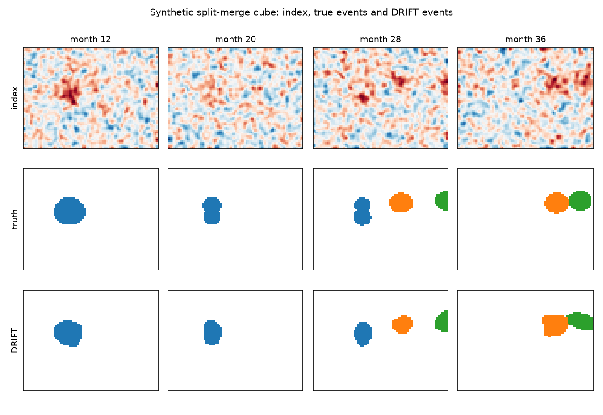
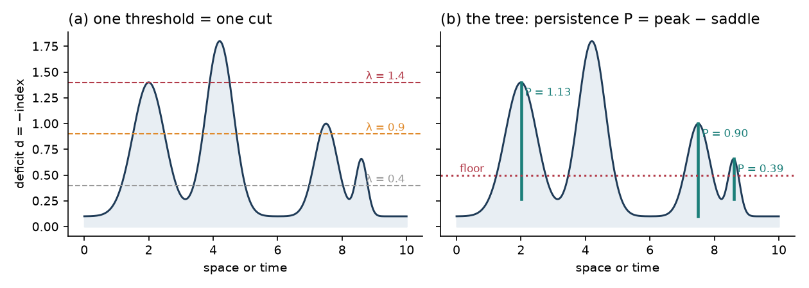
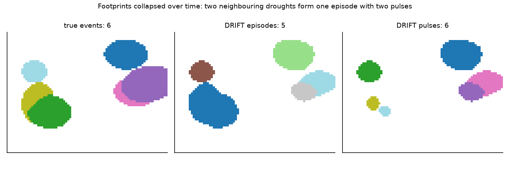
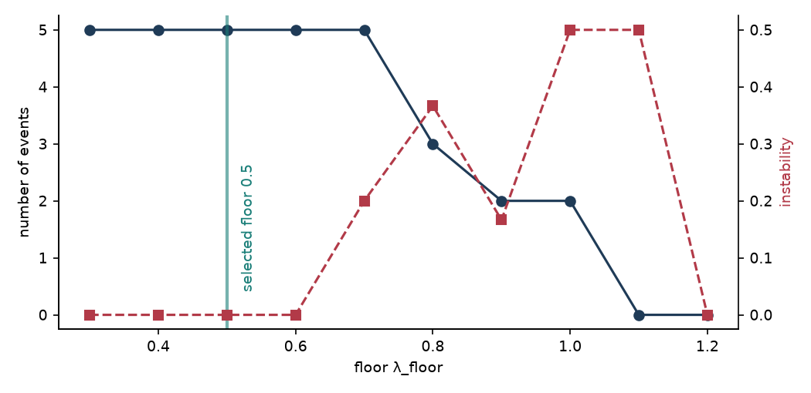
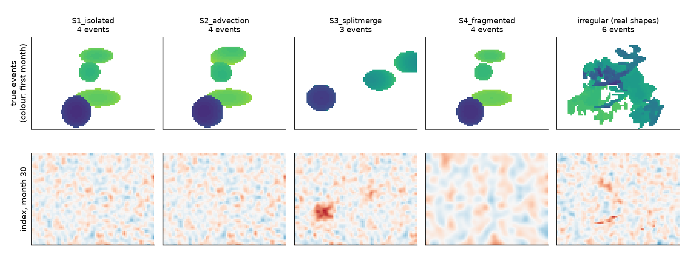
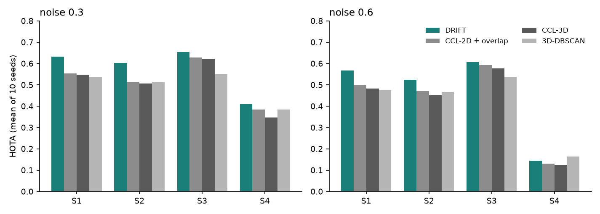

# DRIFT — drought events from the space–time component tree

[](https://github.com/karelsanchez/drift-drought/actions/workflows/tests.yml)
[](https://drift-drought.readthedocs.io)
[](LICENSE)

[](https://doi.org/10.5281/zenodo.24409548)

**DRIFT** (*Drought Regions Identified From the space–time component Tree*) detects drought events in gridded
standardized indices (SPI, SPEI, soil-moisture percentiles) **without fixing a single threshold**. It builds the
max-tree of the deficit field over time, latitude and longitude and selects events inside that hierarchy with
volume-weighted topological persistence, a noise-adaptive persistence threshold and lineage inheritance. One tree
gives two nested levels: drought **episodes** and the **pulses** they contain.

The package also provides everything needed to **test** a drought-event detector: a synthetic benchmark with known
events (Gaussian scenarios and irregular shapes from real droughts), three reference detectors, tracking metrics
(HOTA, object F1, partition agreement), event confidence and a surrogate significance test.



## Contents

- [Why DRIFT](#why-drift)
- [Installation](#installation)
- [Quickstart](#quickstart)
- [How it works](#how-it-works)
- [Evaluation metrics](#evaluation-metrics)
- [Benchmark](#benchmark)
- [Tests and validation](#tests-and-validation)
- [Package structure](#package-structure)
- [Documentation](#documentation) · [Citation](#citation) · [License](#license)

## Why DRIFT

A drought catalogue built by labelling connected cells below one threshold (for example SPI ≤ −1) changes with that
threshold: a strict one breaks droughts into pieces, a lenient one chains separate droughts into multi-year objects.
DRIFT keeps **all thresholds at once** in a component tree and lets each event take its own effective threshold:



*(a) Each threshold gives a different set of events. (b) In the tree, each maximum is a branch with a persistence
P = peak − saddle; shallow branches created by noise are absorbed, droughts separated by deep saddles are kept.*

## Installation

```bash
pip install git+https://github.com/karelsanchez/drift-drought
```

Python ≥ 3.10. Dependencies: NumPy, SciPy, pandas, [Higra](https://higra.readthedocs.io) (component trees), Numba,
scikit-image, scikit-learn and xarray. Extras: `[plot]` (matplotlib), `[test]` (pytest), `[docs]` (Sphinx).

## Quickstart

```python
import numpy as np
import driftdrought as dd

# a benchmark cube (60 months x 60 x 80 cells): one drought splits, two converge
index, truth, meta = dd.synthetic.generate("S3_splitmerge", noise=0.6, seed=3)
area = np.ones(index.shape[1:])                      # unit cells; dd.cell_area_km2() on a lat-lon grid

labels, info = dd.detect(dd.smooth(index, 2.5), area, v_min=50, floor=0.5,
                         footprint="watershed", ext_floor=0.5)

print(dd.metrics.hota(truth, labels, area))          # HOTA 0.574, DetA 0.628, AssA 0.525
print(dd.metrics.object_match(truth, labels, area, iou_thr=0.25)["f1_iou25"])   # 0.86
print(dd.event_table(labels, index, area))           # start, end, duration, volume, peak month...
```

On real data:

```python
spi3 = xr.open_dataset("spi3.nc").spi3                         # (time, lat, lon), NaN over sea
area = dd.cell_area_km2(spi3.lat.values, 0.25)[:, None] * np.ones(spi3.lon.size)
area[np.isnan(spi3.values[0])] = 0
x = dd.smooth(spi3.values, 2.5)
floor, scan = dd.select_floor(x, area, v_min=2e6)              # event-count stability rule
episodes, info = dd.detect(x, area, v_min=2e6, floor=floor)    # km2 x months
pulses, _ = dd.detect(x, area, v_min=2e6, floor=floor, selection="leaf")
```

The complete script is [`examples/quickstart.py`](examples/quickstart.py).

## How it works

| Step | What DRIFT does | Parameter |
|---|---|---|
| 1. Deficit field | `d = −index`, optionally smoothed with a 3-D Gaussian | `smooth(index, sigma)` |
| 2. Component tree | max-tree of `d` with 26-connectivity in time and space | — |
| 3. Significant nodes | volume ≥ `v_min` and deficit ≥ `floor` | `v_min`, `floor` |
| 4. Persistence | branch persistence P = peak − saddle; branches with P < π are absorbed | `persistence="auto:k"`: π = k · 1.4826 · MAD of the high-pass residual |
| 5. Volume weighting | P_V = P · (V / v_min)^γ, so large droughts survive shallow saddles | `pers_gamma` (γ = 1) |
| 6. Lineage inheritance | an event born inside an older event (share ≥ q of its first footprint) takes its identity | `inherit` (q = 0.75) |
| 7. Footprint | birth component, or watershed growth into cells with deficit ≥ `ext_floor` | `footprint`, `ext_floor` |
| 8. Floor | the floor where the number of events is most stable | `select_floor` |

**Episodes and pulses.** `selection="persistence_vl"` (default) returns episodes; `selection="leaf"` returns the
pulses nested in them:



**Event attributes.** `confidence.parameter_confidence` gives each event a confidence (mean best IoU with runs of
perturbed parameters; with another precipitation product it becomes a *product confidence*), and
`significance.surrogate_test` tests each event against phase-randomized surrogates of the field (family-wise and
Benjamini–Hochberg p-values).



## Evaluation metrics

| Metric | Function | Meaning |
|---|---|---|
| **IoU** | — | area-weighted space–time intersection over union of a true and a detected event |
| **Precision, recall, F1** | `metrics.object_match` | one-to-one matching of events (Hungarian) with IoU ≥ 0.5; `f1_iou25` uses IoU ≥ 0.25 |
| **Mean IoU, volume error** | `metrics.object_match` | quality of the matched footprints |
| **Events detected vs true** | `metrics.object_match` (`n_pred`, `n_gt`) | exposes fragmentation (too many) and chaining (too few) |
| **HOTA** | `metrics.hota` | Higher Order Tracking Accuracy (Luiten et al., 2021): √(DetA · AssA), averaged over IoU thresholds 0.05–0.95 |
| **DetA** | `metrics.hota` | detection accuracy: drought cells found in the right months |
| **AssA** | `metrics.hota` | association accuracy: each drought keeps one identity through time |
| **ARI, VI** | `metrics.partition_agreement` | adjusted Rand index and variation of information between two partitions |

Equations and interpretation: [metrics page of the documentation](https://drift-drought.readthedocs.io/en/latest/metrics.html).

## Benchmark

`synthetic.generate` reproduces the known-truth cubes of the DRIFT article; `synthetic.generate_irregular` places
**real drought shapes** — from your own catalogue (`build_library`) or from the bundled library of 99 droughts of the
Amazon and Orinoco basins (`example_library`) — so DRIFT can be tuned to the scale of the target region.



| Scenario | What it tests |
|---|---|
| `S1_isolated` | recovery of separated events |
| `S2_advection` | continuity of migrating events |
| `S3_splitmerge` | identity through a split and two converging droughts |
| `S4_fragmented` | weak events on strongly correlated noise |
| irregular | non-convex, multi-core events with the geometry of observed droughts |

Mini benchmark (`examples/make_figures.py`: four scenarios × two noise levels × ten seeds, configurations selected in
the article):



| Method | HOTA (noise 0.3) | HOTA (noise 0.6) | AssA (0.6) | F1, IoU ≥ 0.25 (0.6) | Events detected (0.6; true 4.6) |
|---|---|---|---|---|---|
| **DRIFT** | **0.575** | **0.461** | **0.496** | **0.78** | 6.8 |
| CCL-2D + overlap | 0.520 | 0.424 | 0.460 | 0.67 | 10.8 |
| CCL-3D | 0.506 | 0.409 | 0.430 | 0.69 | 4.0 |
| 3D-DBSCAN | 0.496 | 0.411 | 0.447 | 0.68 | 5.3 |

In the article (20 seeds, held-out selection of every method) DRIFT reached HOTA 0.579 and 0.459 against at most 0.530
and 0.428, was best in seven of eight scenario–noise combinations and, re-tuned on irregular events from observed
droughts, remained best on average. Weak events in strongly correlated noise (S4) are hard for every method, and at
the smoothing that maximizes HOTA the split in S3 is not reported as a split (DRIFT keeps one identity instead).

## Tests and validation

The test suite runs on GitHub Actions for Python 3.10, 3.11 and 3.12 on every push.

| Test | What it checks |
|---|---|
| `test_generator_is_deterministic` | same scenario, noise and seed → same cube and truth |
| `test_detect_recovers_isolated_events` | HOTA > 0.4 and F1 (IoU ≥ 0.25) > 0.6 on isolated events |
| `test_all_selection_rules_run` | the five selection rules run and return events |
| `test_nan_cells_are_never_events` | cells outside the domain are never labelled |
| `test_merge_branches_joins_a_split` | lineage inheritance gives one identity to a lobe born inside an event |
| `test_baselines_and_confidence` | reference detectors run; a catalogue has confidence 1 against itself |
| `test_select_floor_returns_candidate` | the floor rule returns a candidate floor and the full scan |
| `test_surrogate_test_small` | the significance test returns valid family-wise and FDR p-values |
| `test_example_library` | the bundled real-shape library loads and builds cubes |

```bash
pip install -e ".[test]"
pytest -v
```

**Equivalence with the article.** Before release, `detect` was checked against the research implementation used in
the article on the four benchmark scenarios: the label cubes were identical voxel by voxel.

## Package structure

| Module | Contents |
|---|---|
| `driftdrought.core` | `detect`, `smooth`, `select_floor`, `event_table`, `merge_branches`, `cell_area_km2` |
| `driftdrought.indices` | SPI, SPEI and soil-moisture index fitted per calendar month |
| `driftdrought.synthetic` | benchmark cubes (S1–S4), `build_library`, `example_library`, `generate_irregular` |
| `driftdrought.baselines` | CCL-2D with overlap tracking, CCL-3D, 3D-DBSCAN |
| `driftdrought.metrics` | HOTA (DetA, AssA), object matching, partition agreement |
| `driftdrought.confidence` | event confidence against perturbed parameters or another input product |
| `driftdrought.significance` | phase-randomized surrogate test, family-wise and FDR p-values |

## Documentation

**https://drift-drought.readthedocs.io** — installation, quickstart, method with equations, metrics, benchmark, tests,
gallery and the full API reference generated from the docstrings.

## Citation

If you use DRIFT, please cite the software and the article (see `CITATION.cff`, or "Cite this repository" on GitHub):

> Sanchez H., K. A. (2026). *DRIFT: Drought Regions Identified From the space–time component Tree* (software).
> Zenodo. https://doi.org/10.5281/zenodo.24409548 (all versions; version 0.1.1: https://doi.org/10.5281/zenodo.24409549)

> Sanchez H., K. A. (2026). DRIFT for detecting and tracking spatiotemporal drought events with component trees.
> *Water Resources Research* (submitted).

## License

MIT © 2026 Karel A. Sanchez H. (see [LICENSE](LICENSE)).
