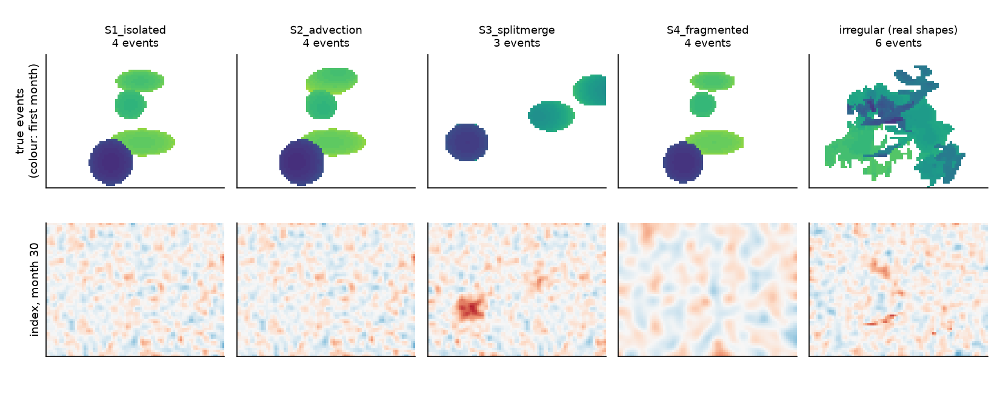
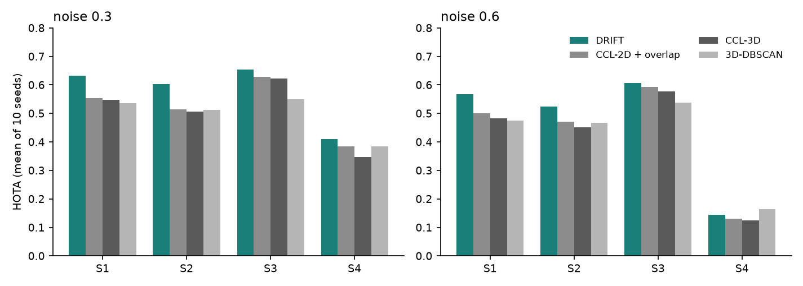

Benchmark
=========

Known-truth cubes
-----------------

:func:`driftdrought.synthetic.generate` reproduces the cubes of the DRIFT paper (60 months × 60 × 80 cells):

========================  ==========================================================
``S1_isolated``           stationary, well-separated events
``S2_advection``          events migrating 0.3–1.2 cells per month
``S3_splitmerge``         one event splits into two lobes; two events converge
``S4_fragmented``         weaker events on strongly correlated noise
========================  ==========================================================

:func:`driftdrought.synthetic.build_library` and :func:`~driftdrought.synthetic.generate_irregular` build cubes with
**irregular, multi-core events taken from real drought shapes** (for example from a DRIFT catalogue of your own
region), so that the method can be tuned to the scale of the target droughts before it is applied. A library of 99
real drought shapes from the Amazon and Orinoco basins is bundled (:func:`~driftdrought.synthetic.example_library`).

Protocol
--------

1. Generate cubes for every scenario, two noise levels (0.3, 0.6) and 20 seeds.
2. For every method, evaluate a grid of configurations; select the configuration with the highest mean HOTA on half
   of the seeds and score it on the other half, and vice versa (held-out selection).
3. Compare methods with paired differences over the evaluation cubes (bootstrap intervals, sign-flip p-values, Holm
   correction).

.. code-block:: python

   import numpy as np
   import driftdrought as dd

   area = np.ones(dd.synthetic.SHAPE[1:])
   rows = []
   for sc in dd.synthetic.SCENARIOS:
       for seed in range(20):
           idx, truth, meta = dd.synthetic.generate(sc, noise=0.6, seed=seed)
           lab = dd.detect(dd.smooth(idx, 2.5), area, v_min=50, floor=0.5, footprint="watershed",
                           ext_floor=0.5, return_info=False)
           rows.append(dict(scenario=sc, seed=seed, **dd.metrics.hota(truth, lab, area)))

Mini benchmark
--------------

The table and the script that produce it are in :doc:`testing`.

Results in the paper
--------------------

With held-out tuning, DRIFT reached HOTA 0.579 (noise 0.3) and 0.459 (noise 0.6), against at most 0.530 and 0.428
for the reference detectors, and was best in seven of eight scenario–noise combinations. On irregular events from
observed drought shapes, with every method re-tuned, it remained best on average (+0.03 to +0.04 HOTA over three
detectors, on par with 3-D connected components), except under strongly correlated noise. See :doc:`citing`.
