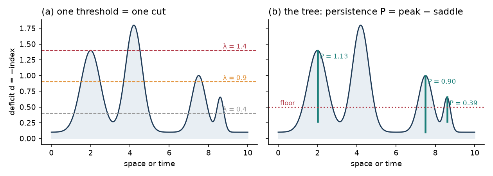

Method
======

From a threshold to a tree
--------------------------

Let :math:`x` be a standardized index on the time–latitude–longitude grid (optionally smoothed with a Gaussian of
width :math:`\sigma`) and :math:`d=-x` the deficit. Labelling the connected cells with :math:`d \ge \lambda` gives a
drought catalogue for one threshold :math:`\lambda`. The **max-tree** stores the connected components of *every*
upper level set :math:`\{d \ge \lambda\}` at once (26-connectivity in space and time); a fixed-threshold catalogue is
one horizontal cut through it.

A node :math:`n` is *significant* when its area-weighted space–time volume :math:`V(n) \ge v_{\min}` and its level
:math:`\lambda(n) \ge \lambda_{\mathrm{floor}}`. Chains of significant nodes are condensed into clusters, which branch
where two or more significant children appear.

Event selection
---------------

Each cluster :math:`c` has a peak deficit :math:`p(c)` and a saddle :math:`s(c)`, the level at which it joins its
siblings. Its **topological persistence** is

.. math:: P(c) = p(c) - s(c).

A maximum created by noise rises little above the saddle that connects it to a larger structure; two droughts are
separated by a deep saddle. At every split the child with the highest peak continues the parent, and every other child
whose persistence is below a threshold :math:`\pi` is absorbed with its subtree. The threshold adapts to the noise of
the field (``persistence="auto:k"``):

.. math:: \pi = k \cdot 1.4826\,\mathrm{MAD}\left[x - G_2(x)\right],

where :math:`G_2` is a Gaussian filter of width 2. **Volume weighting** (``pers_gamma``) lets large branches survive
with a smaller contrast,

.. math:: P_V(c) = P(c)\left(\frac{V(c)}{v_{\min}}\right)^{\gamma},

and **lineage inheritance** (``inherit``) gives event :math:`j` the identity of an older event :math:`i` when at least
a share :math:`q` of its first footprint lay inside :math:`i` in the previous month,

.. math:: \frac{\left|\{L_{t_j-1}=i\} \cap \{L_{t_j}=j\}\right|}{\left|\{L_{t_j}=j\}\right|} \ge q .

Episodes and pulses
-------------------

Because all events come from one tree, DRIFT returns two nested levels: **episodes** (``selection="persistence_vl"``,
the leaves of the simplified tree) and **pulses** (``selection="leaf"``, the leaves of the condensed tree before
simplification). Each pulse lies inside one episode. ``footprint="birth"`` assigns each event its component at the
level where it separates from its siblings; ``footprint="watershed"`` grows the events into all cells with deficit
at least ``ext_floor``, sharing contested cells along deficit saddles.

Choosing the floor
------------------

:func:`driftdrought.select_floor` scans candidate floors and picks the one where the number of events changes least
(event-count stability), excluding floors with fewer than five events or an event longer than a third of the record:

.. math:: \lambda^{\ast}_{\mathrm{floor}} = \arg\min_{\lambda} \frac{1}{2}\left(\frac{|N(\lambda+\Delta)-N(\lambda)|}{N(\lambda)} + \frac{|N(\lambda)-N(\lambda-\Delta)|}{N(\lambda-\Delta)}\right).

Event confidence and significance
---------------------------------

The **confidence** of an event is its mean best overlap with the events of :math:`K` alternative catalogues
(perturbed parameters, or another input product):

.. math:: \mathrm{conf}(e) = \frac{1}{K}\sum_{k=1}^{K} \max_{f \in L_k} \mathrm{IoU}(e, f).

The **significance** compares the volume-weighted deficit contrast of each event,
:math:`S_e = (\max d_e - \lambda_{\mathrm{floor}})(V_e/v_{\min})^{\gamma}`, with the events that the same
configuration finds in phase-randomized surrogates of the field, which keep its space–time spectrum and marginal
distribution. The test is conservative.

Limitations
-----------

* At the smoothing that maximizes tracking accuracy, the two lobes of a splitting drought remain connected; DRIFT keeps
  one identity for them but does not report the split. At monthly resolution no tested description separates a real
  split from noise-induced fragmentation.
* Weak events in strongly correlated noise are detected poorly by every method.
* Pulses depend on the input product; the product confidence identifies the events that are robust to it.
* The floor and the minimum volume remain parameters; tune them for a new region with the benchmark generator
  (:doc:`benchmark`).
