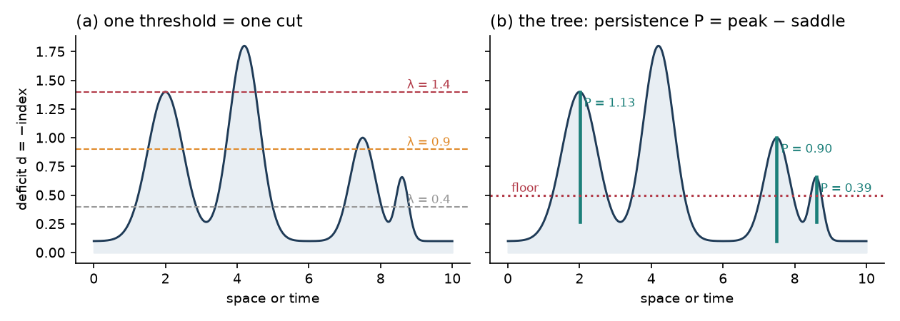
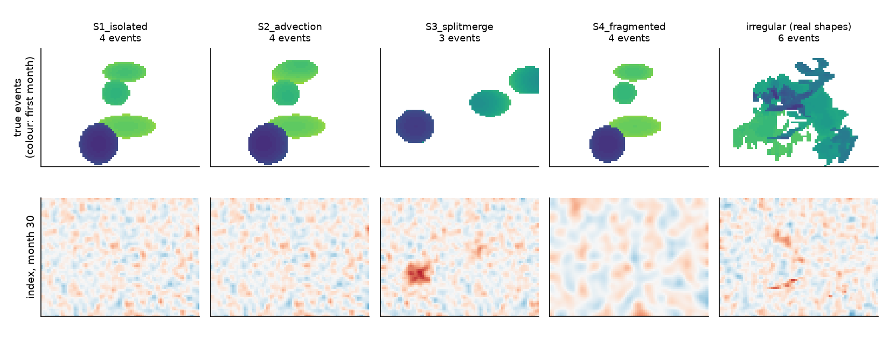
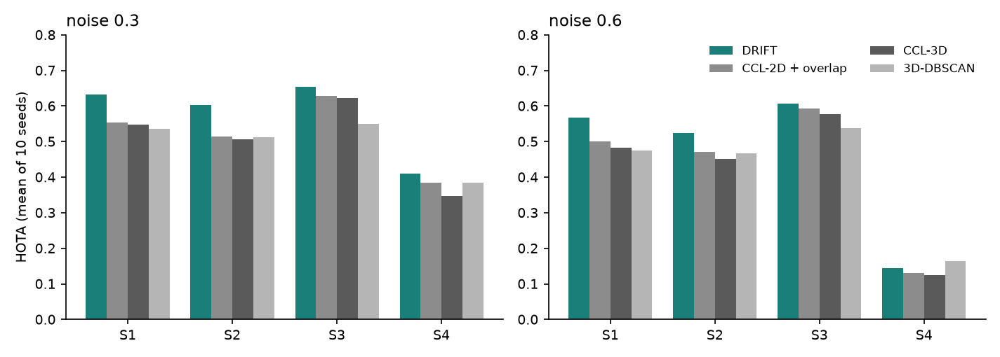
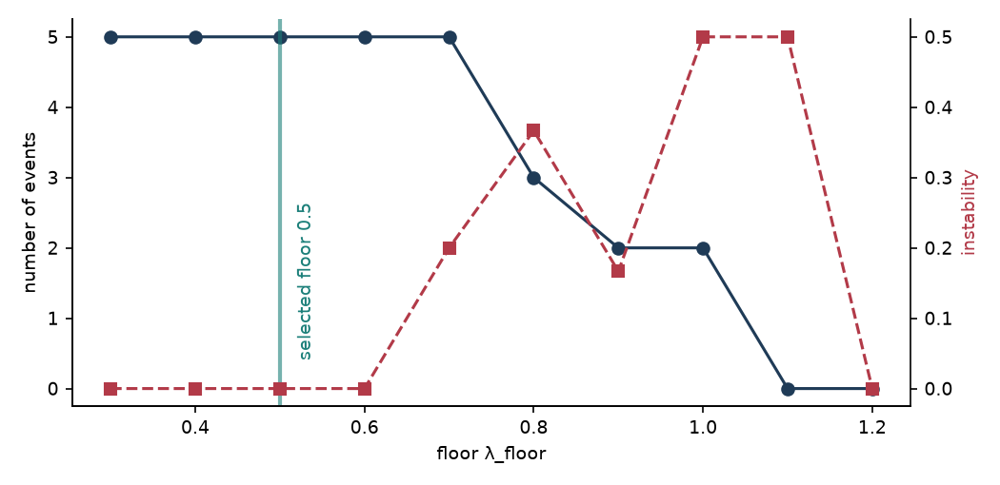
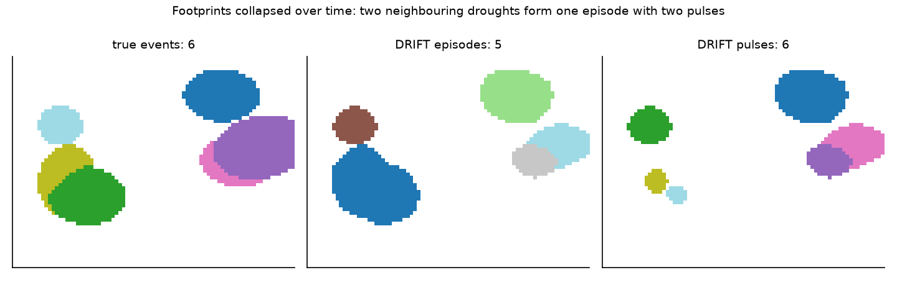
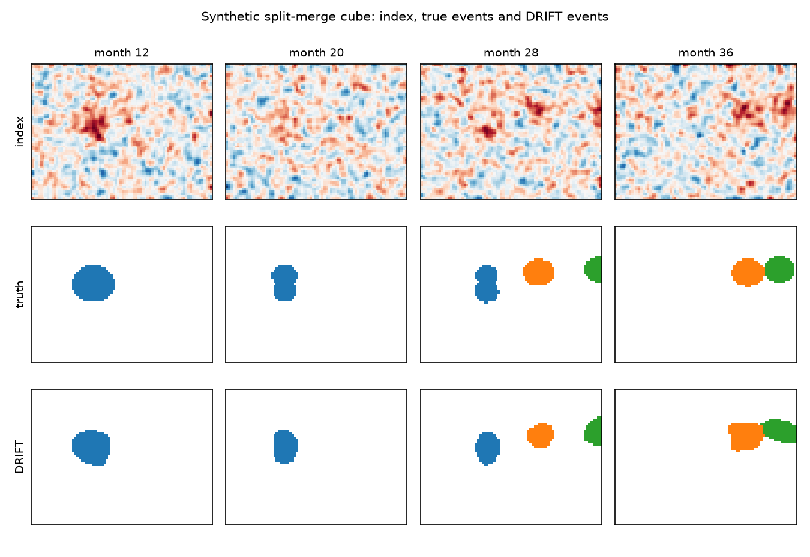

Gallery
=======

All figures are produced by ``examples/quickstart.py`` and ``examples/make_figures.py``.

One threshold versus the whole tree
-----------------------------------

(a) Labelling at one threshold gives a different set of events at every level. (b) DRIFT keeps the whole hierarchy:
each maximum is a branch whose persistence is its peak minus the saddle where it joins a higher branch. Branches with
persistence below the noise-adaptive threshold are absorbed; the small maximum on the right (P = 0.39) is a candidate
for absorption, whereas the deep saddles separate the three droughts.

Benchmark scenarios
-------------------

Top: true events collapsed over time (colour: first month). Bottom: the index in month 30. The last column uses the
bundled library of 99 real drought shapes from the Amazon and Orinoco basins
(:func:`driftdrought.synthetic.example_library`).

DRIFT and reference detectors
-----------------------------

Mean HOTA over ten seeds per scenario. DRIFT scores highest in the isolated, migrating and split–merge scenarios; for
weak events in strongly correlated noise (S4) every method scores low.

Choosing the floor
------------------

Number of events and instability for each candidate floor (:func:`driftdrought.select_floor`). The selected floor is
the most stable one among the eligible floors.

Episodes and pulses
-------------------

Episodes are the events selected by DRIFT; pulses are the leaves of the condensed tree inside them. Here two
neighbouring droughts form one episode that contains two pulses.

Quickstart cube
---------------

