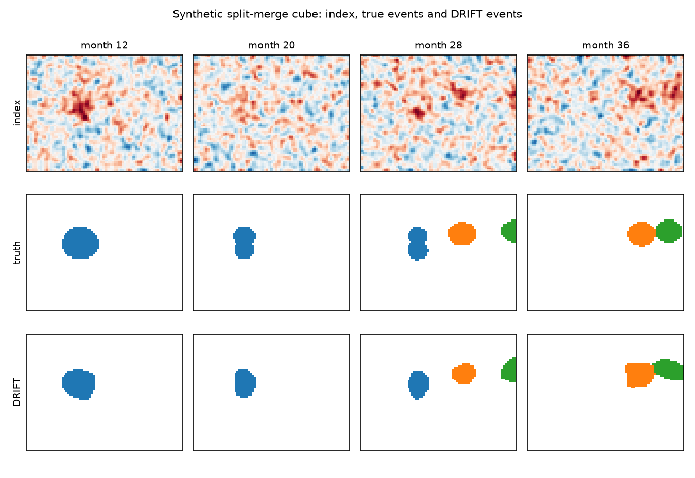

DRIFT: drought events from the space–time component tree
==========================================================

**DRIFT** (*Drought Regions Identified From the space–time component Tree*) detects drought events in gridded
standardized indices (SPI, SPEI, soil-moisture percentiles) without fixing a single threshold. It builds the max-tree of
the deficit field over time, latitude and longitude, and selects events inside that hierarchy with volume-weighted
topological persistence, a noise-adaptive persistence threshold and lineage inheritance. One tree gives two nested
levels: **episodes** and the **pulses** they contain.

The package also contains everything needed to *test* a drought-event detector: a synthetic benchmark with known
events (Gaussian and irregular shapes), three reference detectors, tracking metrics (HOTA, object F1), an event
confidence and a surrogate significance test.

.. toctree::
   :maxdepth: 2
   :caption: Contents

   installation
   quickstart
   concepts
   metrics
   benchmark
   testing
   gallery
   api
   citing
   changelog
