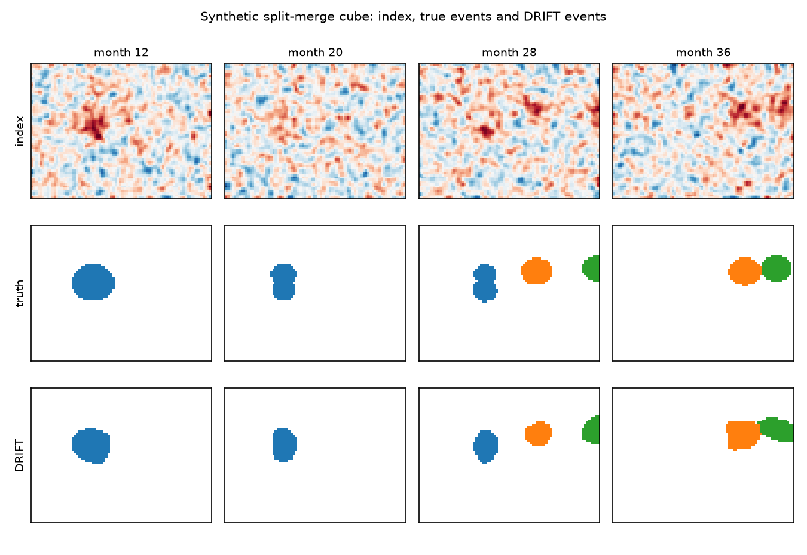

Quickstart
==========

The example builds a benchmark cube in which one drought splits into two lobes and two others converge, runs DRIFT
with the configuration selected in the benchmark, compares it with a three-dimensional connected-component detector
and scores both against the known events.

.. literalinclude:: ../examples/quickstart.py
   :language: python
   :lines: 9-31

Output (scores against the known truth)::

   DRIFT   HOTA 0.574  DetA 0.628  AssA 0.525  F1(IoU>=0.25) 0.86  events 4 (true 3)
   CCL-3D  HOTA 0.493  DetA 0.390  AssA 0.636  F1(IoU>=0.25) 0.80  events 2 (true 3)

DRIFT finds the three droughts with a higher detection accuracy (DetA) than one cut at a single threshold. It
describes the splitting drought as two events (its parent and its lobes), which costs association accuracy (AssA):
at this smoothing the split itself is not recognised, a limitation discussed in :doc:`concepts`.

Real data
---------

On a latitude–longitude grid, give DRIFT the cell areas and a minimum volume in km² × months:

.. code-block:: python

   import numpy as np, xarray as xr
   import driftdrought as dd

   spi3 = xr.open_dataset("spi3.nc").spi3                      # (time, lat, lon), NaN over sea
   area = dd.cell_area_km2(spi3.lat.values, 0.25)[:, None] * np.ones(spi3.lon.size)
   area[np.isnan(spi3.values[0])] = 0
   x = dd.smooth(spi3.values, 2.5)
   floor, scan = dd.select_floor(x, area, v_min=2e6)          # event-count stability rule
   labels, info = dd.detect(x, area, v_min=2e6, floor=floor)  # episodes
   pulses, _ = dd.detect(x, area, v_min=2e6, floor=floor, selection="leaf")   # pulses
   table = dd.event_table(labels, spi3.values, area, times=spi3.time.values)
